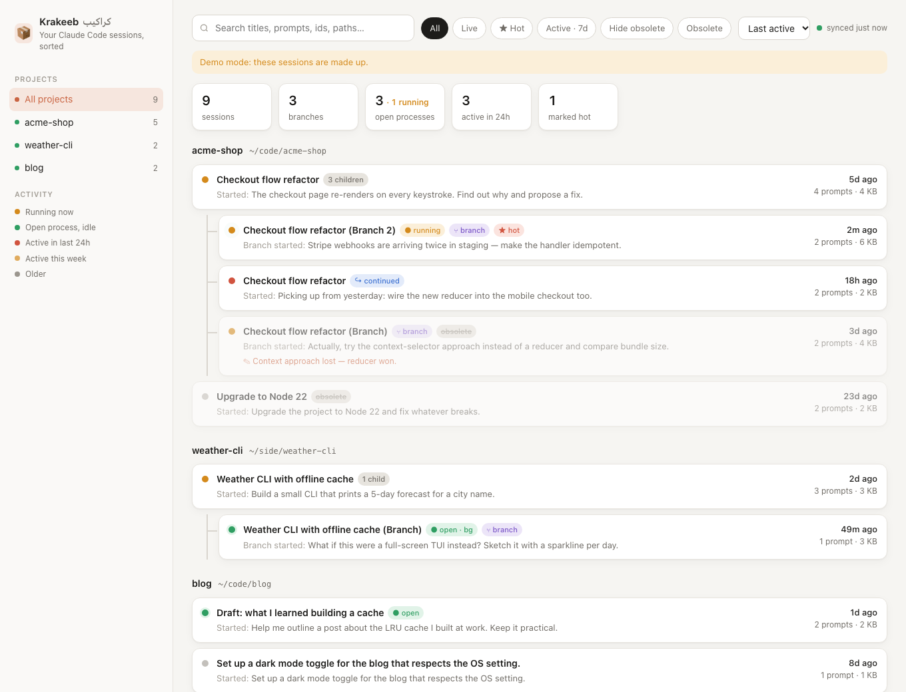
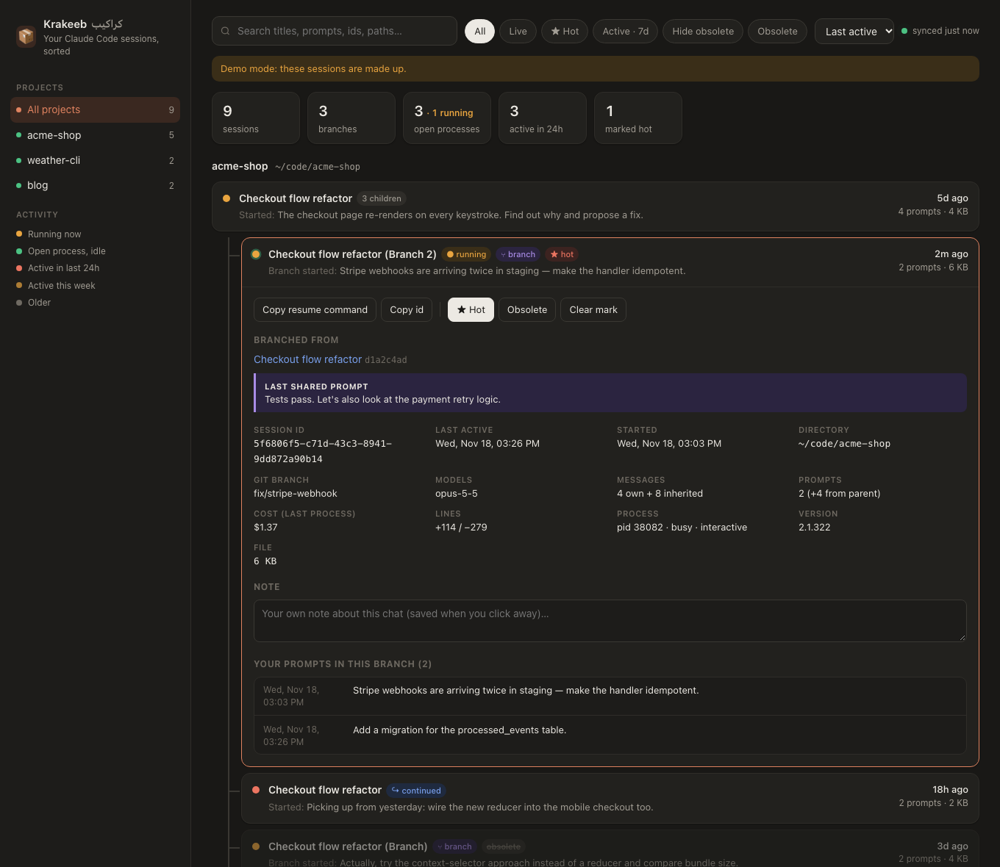

# Krakeeb · كراكيب

**A local page for browsing all your Claude Code sessions as a tree, so you can see what's still running and sort out the clutter.**

> *karakeeb* (كراكيب) is Arabic for the clutter that piles up in the corner of the house: old stuff someone will sort out one day. Every Arab parent has said "لمّوا الكراكيب دي" ("gather up this clutter"). After a few weeks of branching, resuming and backgrounding Claude Code chats, your sessions look a lot like that.



## What it does

Claude Code saves every session in `~/.claude/projects`. Krakeeb reads those files and shows them as one page:

- **A tree of your chats.** Branches sit under the chat they were forked from, and continued sessions sit under the original.
- **What's still running.** Sessions with a live `claude` process are marked *running* or *open*, including background sessions you may have forgotten.
- **When each chat was last active**, plus its title (your `/rename`, else Claude Code's own auto title, else the first prompt).
- **How each chat started.** For a branch, that's the first prompt after the split, plus the last prompt it shares with its parent.
- **Everything else already on disk:** every prompt you typed, git branch, models, cost, lines changed, subagents and published artifacts.
- **Sorting the clutter:** mark chats ★ Hot or Obsolete, add notes, filter and search. Obsolete chats are dimmed.
- **Resuming:** copy the `claude --resume` command, or on macOS open it straight in Terminal.



**It's read-only and local.** It never changes anything in `~/.claude`. Your marks and notes go to their own file (`~/.claude/krakeeb/marks.json`). The server listens on `127.0.0.1` only, loads nothing from the internet, and makes **no LLM calls**: everything shown is already on disk.

## Install

Requires Python 3.9+ (standard library only) and `curl`.

### As a Claude Code plugin (recommended)

In Claude Code:

```
/plugin marketplace add AAshrafHussein/claude-krakeeb
/plugin install krakeeb@krakeeb
```

Restart Claude Code, then open **http://127.0.0.1:8765** and bookmark it.

### Manually

```sh
git clone https://github.com/AAshrafHussein/claude-krakeeb ~/claude-krakeeb
```

Then add this to `~/.claude/settings.json`, merged with any hooks you already have:

```json
{
  "hooks": {
    "SessionStart": [
      { "hooks": [ { "type": "command", "command": "sh ~/claude-krakeeb/start.sh", "timeout": 5 } ] }
    ]
  }
}
```

Or skip the hook and run it whenever you want: `python3 ~/claude-krakeeb/server.py`.

## How it runs

There's no login item, no daemon and no cron job.

1. Each time you start `claude`, a `SessionStart` hook runs `start.sh`. If the server isn't already up, the script starts it in the background. This takes a few milliseconds and uses no model.
2. The page refreshes itself every 8 seconds. Only session files that changed are re-read.
3. Once a minute the server checks whether any Claude Code process is still alive. After 10 minutes with none, it exits.

Long-lived background sessions count as "alive". Set `KRAKEEB_IGNORE_BG=1` if you only want open terminal sessions to keep it running.

## Configuration

Set these as environment variables, e.g. in the `env` block of `~/.claude/settings.json`:

| Variable | Default | Meaning |
|---|---|---|
| `KRAKEEB_PORT` | `8765` | Port to serve on |
| `KRAKEEB_IDLE_MIN` | `10` | Minutes with no live session before the server exits (`0` = never) |
| `KRAKEEB_IGNORE_BG` | `0` | `1` = background sessions don't keep the server alive |
| `KRAKEEB_DATA_DIR` | `~/.claude/krakeeb` | Where marks, notes and the log are stored |
| `CLAUDE_CONFIG_DIR` | `~/.claude` | Respected if you've moved your Claude Code config |

## Try it without your own data

```sh
python3 server.py --demo     # made-up sessions on http://127.0.0.1:8799
```

The screenshots above come from this demo.

## Caveats

- **This relies on Claude Code's on-disk session format, which isn't a public API** and can change in any release. Tested with Claude Code 2.1.3xx. If something looks off after an update, please open an issue.
- **macOS and Linux.** "Resume in Terminal" is macOS only. On Windows, detection of running sessions is turned off and everything else is untested.
- Branch and continuation links come from fields Claude Code records (`forkedFrom`, `continued-in`). Rewinds within a single session aren't shown as separate branches.

## Uninstall

Plugin: `/plugin uninstall krakeeb@krakeeb`. Manual: remove the hook from `settings.json` and delete the folder. Your marks live in `~/.claude/krakeeb/`; delete that too if you like.

## License

MIT. This is an unofficial community project and isn't affiliated with or endorsed by Anthropic. "Claude" and "Claude Code" are trademarks of Anthropic.
